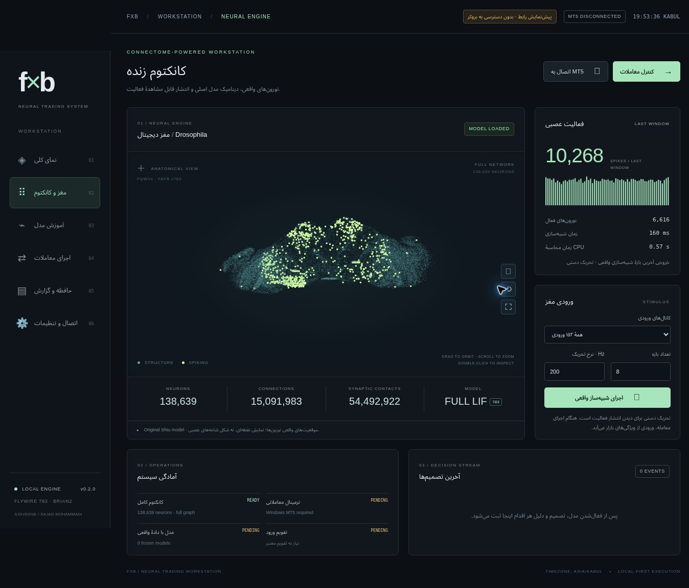

# FXB — Neural Trading Workstation

نسخهٔ **0.2.2** یک برنامهٔ محلی برای Windows/VPS است: رابط مدیریت، مدل کامل شبیه‌سازی مغز مگس، آموزش سیاست معامله و موتور ارسال سفارش به MT5 برای XAUUSD و نماد دقیق CFD شاخص US100 نزد بروکر.

**مسیر نرم‌افزاری حساب واقعی پیاده شده است. سودآوری و وین‌ریت هنوز اندازه‌گیری نشده‌اند:** در این محیط به ترمینال و تاریخچهٔ حساب شما دسترسی نداریم. هیچ مدل آمادهٔ سودآور، نتیجهٔ ساختگی بازار یا معاملهٔ واقعی در خروجی این توسعه وجود ندارد.



این تصویر از اجرای واقعی پنل و تحریک دستی شبیه‌ساز گرفته شده است؛ حساب بروکر متصل نیست.

## نصب و بازکردن رابط

Python **3.12، 64-bit** و Git را روی Windows نصب کنید. MT5 باید روی همان سیستم یا VPS نصب و به حساب مورد نظر وارد شده باشد.

```powershell
git clone https://github.com/sjdpluse/fxb.git
cd fxb
powershell -NoProfile -ExecutionPolicy Bypass -File .\Start-FXB.ps1
```

فرمان بالا سیاست PowerShell را فقط برای همان پردازش تنظیم می‌کند. راه‌انداز محیط مجازی و وابستگی‌های ثابت را نصب، دادهٔ کانکتوم را دریافت و پنل را در مرورگر باز می‌کند. دریافت اولیهٔ داده حدود ۱۰۹ مگابایت است؛ نصب کتابخانه‌های علمی جداگانه حجم بیشتری دارد. دانلود مدل سرمایه یا حساب معاملاتی را مصرف نمی‌کند.

اجرای دستی، یا اجرای بعدی بدون نصب دوباره:

```powershell
py -3.12 -m venv .venv
.\.venv\Scripts\python.exe -m pip install -e ".[brain,desktop,mt5]"
.\.venv\Scripts\python.exe -m fxb brain-install
.\.venv\Scripts\python.exe -m fxb serve
```

پنل عادی فقط روی `http://127.0.0.1:8765` گوش می‌دهد. از لینکی استفاده کنید که برنامه باز می‌کند؛ کلید محلی در بخش fragment لینک قرار دارد و به لاگ HTTP نمی‌رود. لینک و `state/owner.token` خصوصی‌اند. پورت پنل را روی اینترنت باز نکنید. استفاده از Remote Desktop روی VPS امکان دیدن همین پنل را فراهم می‌کند.

## مسیر کار در پنل

1. **مغز و کانکتوم:** موقعیت واقعی همهٔ نورون‌ها را ببینید؛ با ماوس بچرخانید، بزرگ کنید و با دوبارکلیک شناسه و اتصال‌های واقعی یک نورون را بخوانید. «اجرای شبیه‌ساز واقعی» ورودی دستی می‌فرستد و اسپایک واقعی تولید می‌کند. هنگام معامله، ورودی از کندل‌های بسته‌شده می‌آید.
2. **اتصال و تنظیمات:** شمارهٔ حساب، نام دقیق سرور و در صورت نیاز مسیر `terminal64.exe` را وارد کنید. رمز حساب در برنامه ذخیره نمی‌شود.
3. **آموزش مدل:** نماد دقیق Market Watch، تعداد کندل و هزینه‌های واقعی حساب را تعیین و تاریخچهٔ M5 را دریافت کنید. برای طلا و US100 مدل مستقل بسازید. پردازشگر پیش‌فرض پنل، کل کانکتوم است.
4. **گزارش مدل:** نتیجهٔ train/validation/holdout، معاملات، بازده، افت سرمایه و profit factor را ببینید. وین‌ریت تنها یکی از معیارهاست؛ کم‌بودن تعداد معامله یا نمونهٔ کوتاه به معنای اثبات مزیت نیست.
5. **تقویم اقتصادی:** فایل معتبر JSON را بارگذاری کنید. ساختار در `configs/news.example.json` است؛ خود فایل نمونه عمداً منقضی است. تقویم باید پوشش معتبر، زمان به‌روزرسانی زیر ۲۴ ساعت و اخبار مهم USD داشته باشد. این نسخه منبع خودکار اخبار ندارد.
6. **اجرای معاملات:** یک یا دو مدل را انتخاب کنید. `Dry run` تحلیل بدون ارسال، `Demo` معاملهٔ حساب دمو و `Live` معاملهٔ حساب واقعی است. برای Live شمارهٔ همان حساب باید تایپ شود؛ فعال‌سازی به سرور، SHA-256 مدل‌ها و حدود ریسک محدود است و زمان انقضا دارد.
7. **کنترل:** توقف ورود، بستن موقعیت ربات، خاموش‌کردن موتور و تطبیق سفارش مبهم جدا هستند. خاموش‌کردن موتور به‌تنهایی پوزیشن را نمی‌بندد. درخواست بستن تا تأیید بروکر بسته‌شدن محسوب نمی‌شود.

پس از بسته‌شدن برنامه، فعال‌سازی Live حفظ نمی‌شود؛ راه‌اندازی بعدی نیاز به فعال‌سازی صریح دارد. ژورنال، وضعیت ریسک و رزرو سفارش‌ها روی دیسک باقی می‌مانند. اجرای هم‌زمان چند کپی روی یک حساب یا تغییر دستی فایل وضعیت پشتیبانی نمی‌شود.

## زمان بروکر و UTC

نسخهٔ 0.2.1 زمان تیک، کندل، پوزیشن و Deal را در مرز اتصال به UTC تبدیل می‌کند. کنترل قیمت کهنه، مدت نگهداری، شمارش معاملات روز کابل و تقویم خبر همگی با UTC کار می‌کنند. اختلاف ساعت، مجوز عبور از کنترل تازگی نیست. ساعت Windows باید با NTP همگام باشد.

نسخهٔ 0.2.2 خطای `vars() argument must have __dict__ attribute` در همین مسیر را رفع می‌کند: رکوردهای بومی MT5 از طریق `_asdict()` خوانده می‌شوند و همهٔ فیلدهای غیرزمانی حفظ می‌شوند. برای این اصلاح نیازی به تغییر تنظیم ساعت یا دریافت مجدد دادهٔ کانکتوم نیست.

پیش‌فرض `UTC` برای APIهایی است که واقعاً UTC می‌دهند. در «اتصال و تنظیمات» برای سروری که زمان محلی را به‌صورت epoch برمی‌گرداند، مبنای زمان را مشخص کنید:

- اختلاف ثابت مانند `+02:00` همراه تاریخ شروع و پایان UTC. این مقدار تنها در بازهٔ تعیین‌شده معتبر است و به تاریخ‌های قدیمی تعمیم داده نمی‌شود.
- منطقهٔ IANA مانند `Europe/Helsinki` فقط اگر همان قاعدهٔ تغییر ساعت برای سرور تأیید شده باشد.
- `NY+7` فقط برای سرورهایی که رسماً ساعت نیویورک + هفت ساعت و تغییر ساعت آمریکا را دنبال می‌کنند. این انتخاب برای هیچ بروکری به‌صورت خودکار فعال نمی‌شود.

مثال نحوهٔ نوشتن بازه: `2026-11-02T00:00:00Z` تا `2026-12-01T00:00:00Z`. این مثال تأیید تاریخی یک بروکر نیست. اگر فقط اختلاف فعلی معلوم است، قانون سالانه یا زمان داده‌های تابستان را نمی‌توان از آن نتیجه گرفت. برای آموزش اولیه می‌توان با فرض اعلام‌شده از داده‌های اخیرِ داخل یک دورهٔ بدون تغییر ساعت استفاده کرد؛ قبل از استفادهٔ عملیاتی، بازه و قرارداد زمانی سرور باید تأیید شود.

دادهٔ خارج از بازه، ساعت تکراری/ناموجود در مرز DST و مدل ساخته‌شده با مبنای زمانی متفاوت رد می‌شود. اطلاعات تبدیل زمان همراه CSV و مدل ذخیره و در اثرانگشت داده لحاظ می‌شود. گسترش بازه بدون تغییر قاعدهٔ تبدیل، مدل را ناسازگار نمی‌کند؛ تغییر قاعده نیاز به دریافت دوباره و اعتبارسنجی مدل دارد. گزارش تشخیصی قدیمی زمان خام را چاپ می‌کند و تنظیم جدید برنامه را اعمال نمی‌کند.

CLI همان تنظیم را با `--broker-zone`، `--clock-valid-from` و `--clock-valid-until` در فرمان‌های `export-mt5`، `demo` و `reconcile` می‌پذیرد. فایل تقویم اقتصادی همیشه UTC/offset صریح است و نباید همراه ساعت بروکر جابه‌جا شود.

پس از ذخیرهٔ تنظیمات اتصال، بررسی بدون ارسال سفارش:

```powershell
.\.venv\Scripts\python.exe -m fxb clock-check --symbols XAUUSD.m US100.std
```

نام‌ها را مطابق حساب خود وارد کنید. نتیجه باید `ready: true` و زمان UTC نزدیک ساعت همگام‌شدهٔ Windows داشته باشد. خروجی، قیمت قابل معامله یا مجوز اجرای مدل را تضمین نمی‌کند؛ این بررسی فقط اتصال و مبنای زمان را می‌سنجد.

`Update-FXB.ps1 -ProjectRoot . -Revision <commit-sha>` نصب Git یا ZIP را به commit مشخص به‌روز می‌کند. پیش از اجرا FXB را متوقف کنید. نصب ZIP از فایل‌های برنامه نسخهٔ پشتیبان می‌گیرد؛ دادهٔ کانکتوم، مدل‌ها، تنظیمات و محیط مجازی حفظ می‌شوند. نصب Git فقط fast-forward را می‌پذیرد و تغییرات محلی فایل‌های tracked را بازنویسی نمی‌کند.

## دریافت تاریخچه برای آماده‌سازی آموزش

اگر فقط اختلاف زمان فعلی معلوم است، خروجی‌گیر زیر کندل‌های بسته‌شده و مشخصات قرارداد را بدون حدس‌زدن ساعت تاریخی یا هزینه‌ها در `diagnostics/fxb-market-data-*.zip` ذخیره می‌کند. با محیط نصب‌شدهٔ 0.2.2 کار می‌کند و می‌توان خود اسکریپت را از مسیر موقت اجرا کرد:

```powershell
.\.venv\Scripts\python.exe .\scripts\export_market_data.py --root . --symbols XAUUSD.m US100.std --bars 20000
```

MT5 باید روی همان حساب و سرور ذخیره‌شده در FXB باز باشد. قبل از دریافت، تازگی قیمت و پس از دریافت، تازگی آخرین کندل بسته‌شده کنترل می‌شود. تبدیل زمان فقط برای همین بررسی فعلی است؛ زمان‌های تاریخی در CSV با نام `mt5_time_raw` دست‌نخورده می‌مانند. فایل manifest شامل مشخصات قرارداد، واحدهای قیمت و اسپرد، snapshot مارجین، بازهٔ داده و SHA-256 هر CSV است. شمارهٔ حساب، نام صاحب حساب، رمز، توکن و معاملات شخصی وارد بسته نمی‌شوند.

این بسته مستقیماً دیتاست آموزش FXB نیست. پس از بررسی قاعدهٔ زمان، کیفیت کندل‌ها و فرض‌های صریح هزینه، باید از آن دیتاست UTC با metadata سازگار ساخته شود. مقدار نامعلوم کمیسیون، لغزش و هزینهٔ شبانه `null` می‌ماند؛ مقدار خام Swap در Specification به معنی مبلغ نهایی به ارز حساب نیست. خروجی‌گیر هیچ سفارش معاملاتی ارسال نمی‌کند و فایل‌های موجود را بازنویسی نمی‌کند.

## مدل اصلی واقعاً چه چیزی است؟

کد `model.py` از [ریپوی اصلی نویسندگان مدل مغز](https://github.com/philshiu/Drosophila_brain_model)، بدون تغییر در `src/fxb/upstream/shiu_model.py` نگهداری شده است. نسخهٔ ثابت:

`91bdd1e7dcf193f3e7ca5a8933497fcef63b7960`

| جزء | مقدار / رفتار |
|---|---|
| نورون‌های مدل منتشرشده | **۱۳۸٬۶۳۹** |
| اتصال‌های جهت‌دار وزن‌دار | **۱۵٬۰۹۱٬۹۸۳** |
| مجموع تماس‌های سیناپسی | **۵۴٬۴۹۲٬۹۲۲** |
| مدل نورون | Leaky integrate-and-fire در Brian2؛ پارامترها و وزن‌های اصلی |
| داده | `Completeness_783.csv` و `Connectivity_783.parquet`؛ اندازه و SHA-256 ثابت |
| نمای مغز | مختصات واقعی FlyWire v783؛ شناسه‌ها به‌صورت رشته، بدون از دست‌رفتن دقت عددی |
| رابط بازار | ۱۹ ویژگی علّی → ۱۵۲ ورودی Poisson → کل شبکه → ۶۴ گروه فعالیت |
| تصمیم | ۱۹ ویژگی + ۶۴ خروجی عصبی + ۵ ویژگی وضعیت حساب → Double-DQN |
| یادگیری | به‌روزرسانی واقعی وزن‌های شبکهٔ سیاست؛ اتصالات زیستی اصلی ثابت‌اند |
| عمل‌ها | انتظار، خرید، فروش، بستن موقعیت |

این تعداد نورون مربوط به **نسخهٔ مدل محاسباتی نویسندگان** است و نباید با تعداد کل نورون‌های بازسازی آناتومیکی در تمام انتشارهای FlyWire یکی فرض شود. شبیه‌سازی هیچ زیرگرافی را جایگزین کل مدل نمی‌کند. نمایش نقطه‌ها، موقعیت نورون‌هاست و بازسازی شاخه‌های کامل سلولی نیست. نما فقط حداکثر ۴۰۰۰ نورون فعال را رنگ می‌کند؛ شمارش و محاسبه همچنان روی همهٔ نورون‌ها است.

نگاشت بازار به نورون‌ها طراحی مهندسی ماست. مغز مگس ذاتاً قوانین بازار را نمی‌داند و شبیه‌سازی کانکتوم به‌تنهایی توانایی مدل زبانی، استدلال اقتصادی یا سودآوری ایجاد نمی‌کند. مسیر مقایسهٔ بدون کانکتوم حفظ شده تا بتوان ارزش افزودهٔ همین بخش را سنجید. [منبع و مجوزها](THIRD_PARTY.md).

## آموزش، پاداش و حافظه

ویژگی‌ها از کندل بسته‌شده، روند، بازده چند بازه، ATR، نوسان، شکل کندل، شکست محدوده، حجم تیک، اسپرد و زمان ساخته می‌شوند. scaler فقط روی بخش آموزش برازش می‌شود. تفکیک زمانی ۶۰/۲۰/۲۰ با فاصلهٔ محافظ انجام می‌شود؛ انتخاب مدل با validation و گزارش نهایی با holdout است.

پاداش، تغییر لگاریتمی equity **پس از هزینه‌ها** با جریمهٔ افزایش افت سرمایه و ورود اضافی است. یک معاملهٔ سودده به‌تنهایی برهان «تصمیم درست» نیست. آموزش از replay، target network، Adam و Double-DQN استفاده می‌کند. مدل فعال حین معامله خودسرانه وزن‌هایش را عوض نمی‌کند؛ بازآموزی، گزارش و فعال‌سازی نسخهٔ جدید جداست.

```powershell
python -m fxb train --data data/gold.csv --full-brain --out runs/gold-brain --epochs 10
python -m fxb train --data data/gold.csv --plain --out runs/gold-control --epochs 10
python -m fxb walk-forward --data data/gold.csv --full-brain --out runs/gold-walk --folds 3 --epochs 10
python -m fxb evaluate --data data/gold.csv --model runs/gold-brain/model.npz
```

فرمان `train` بدون `--full-brain` همچنان کنترل کوچک نسخهٔ قبلی را اجرا می‌کند؛ پنل صریحاً کل مغز را پیش‌فرض انتخاب می‌کند. خروجی‌ها:

- `model.npz`: سیاست، scaler، قرارداد، ریسک، منبع، نسخه و hash نگاشت عصبی؛ بدون pickle.
- `brain_embeddings.npz`: خروجی پردازش کل مغز برای همان تاریخچه.
- `report.json` و `holdout_trades.json`: ارزیابی و جزئیات معاملات.
- `memory.sqlite`: تجربه‌های آموزش با زمان دسترسی به نتیجه؛ مستقل از ژورنال معاملات جاری.

دایرکتوری هر آموزش جدید باید تازه باشد. ادامهٔ دقیق optimizer/replay از checkpoint و بازآموزی خودکار پیاده نشده است. پردازش ۲۰ میلی‌ثانیهٔ عصبی در آزمایش این محیط حدود ۱.۲ تا ۱.۵ ثانیه CPU طول کشید؛ این معیار سرعت بازار یا تضمین سرعت روی لپ‌تاپ نیست. اجرای زنده فقط کندل‌های جدید را پردازش می‌کند و پس از شروع، ۶۴ کندل برای گرم‌کردن حالت می‌خواند. وضعیت عصبی پس از restart دقیقاً معادل اجرای بی‌وقفه تضمین نمی‌شود؛ اثر آن باید در ارزیابی بررسی شود.

## کنترل ریسک و سفارش

حدود پیش‌فرض در checkpoint ثابت‌اند: ریسک ۰.۲۵٪ هر معامله، توقف روزانه ۲٪، توقف افت سرمایه ۶٪، حداکثر ۶ ورود روزانه، یک موقعیت در کل حساب و حداکثر نگهداری ۱۲ کندل M5. این مقادیر تنظیم اولیهٔ نرم‌افزارند، نه تجویز مناسب‌بودن برای هر حساب.

حجم با `order_calc_profit` و `order_calc_margin` همان بروکر و ارز حساب محاسبه و رو به پایین گرد می‌شود. حداقل لات اگر از بودجه بیشتر باشد، ورود رد می‌شود. SL/TP، قابلیت قرارداد، اسپرد، تازگی قیمت، مارجین و `order_check` بررسی می‌شوند. **CFD US100 و MNQ قرارداد یکسان ندارند.**

رزرو سفارش قبل از `order_send` پایدار می‌شود. پاسخ نامعلوم دوباره ارسال نمی‌شود؛ وضعیت آن پس از restart نیز باقی می‌ماند. سفارش نیمه‌پرشده خودکار تکمیل نمی‌شود. پوزیشن دستی یا سفارش موجود جلوی ورود جدید را می‌گیرد. ربات تنها پوزیشن متعلق به magic خودش را می‌بندد.

اعتبار Live منقضی‌شده ورود جدید را مسدود می‌کند، اما خروج از پوزیشن متعلق به همان مدل/حساب همچنان مجاز است. فایل `STOP` ورود را متوقف و خروج ریسک را درخواست می‌کند. اختلال داده/ترمینال باعث انتظار و ثبت دلیل می‌شود؛ سفارش مبهم به تطبیق نیاز دارد. فایل قفل worker پس از crash فقط وقتی حذف شود که نبودن پردازش دیگر و وضعیت سفارش‌ها روشن باشد.

```powershell
python -m fxb reconcile --mode live --server YOUR_EXACT_SERVER --login 12345678 --db state/runtime.sqlite
```

در اتصال واقعی نام سرور و شمارهٔ نمونه را جایگزین کنید. زمان داده‌ها UTC و روز محاسبهٔ محدودیت روزانه و نمایش پنل `Asia/Kabul` است. واریز/برداشت و عملیات دستی می‌توانند آمار equity را منحرف کنند؛ حساب اختصاصی این مسئله را کاهش می‌دهد. گپ، قطع شبکه و لغزش می‌توانند زیان واقعی را از ریسک هدف بیشتر کنند.

## حافظهٔ Supabase

ثبت محلی بدون Supabase کار می‌کند. جدول مستقل `public.fxb_events` در پروژهٔ فعال متصل ساخته و عملیات insert/upsert/read با نقش backend در یک transaction آزمایش و rollback شد. RLS فعال است، دسترسی `anon/authenticated` لغو شده و backend فقط SELECT/INSERT/UPDATE دارد. هیچ تجربهٔ آزمایشی در جدول باقی نماند. `sql/bootstrap_supabase.sql` برای ساخت جدول در **پروژهٔ جدید دیگر** است؛ آن را برای جدول ساخته‌شده دوباره اجرا نکنید.

برای اتصال برنامهٔ Windows به همین حافظه، متغیرهای محیطی backend را به‌صورت محلی تنظیم کنید؛ فایل `.env` خودکار خوانده نمی‌شود و کلید secret در ریپو قرار ندارد. اتصال HTTP با کلید محیط Windows هنوز نیاز به آزمون دارد:

```powershell
$env:FXB_SUPABASE_URL="https://YOUR_PROJECT.supabase.co"
$env:FXB_SUPABASE_SECRET_KEY="sb_secret_REPLACE_LOCALLY"
python -m fxb memory --db runs/gold-market/memory.sqlite
python -m fxb memory --db runs/gold-market/memory.sqlite --sync
```

هر رویداد UUID پایدار دارد؛ upsert مجدد رکورد تکراری تولید نمی‌کند. اگر اتصال قطع شود، رویدادها pending می‌مانند. سینک در این نسخه با فرمان صریح انجام می‌شود؛ worker معاملاتی به پاسخ Supabase وابسته نیست. کلید secret هرگز در frontend یا GitHub قرار نمی‌گیرد. دفتر پنل در `state/runtime.sqlite` و دفتر فرمان قدیمی دمو در `state/demo.sqlite` جدا از تجربه‌های آموزش‌اند.

## وضعیت آزمون و موارد باقی‌مانده

[گزارش اعتبارسنجی](docs/VALIDATION.md) و [روش ارزیابی](docs/RESEARCH_PROTOCOL.md) جزئیات قابل بررسی را نگه می‌دارند. آزمون‌ها بدون اتصال به حساب شما انجام شده‌اند؛ اجرای واقعی Windows/بروکر هنوز باید انجام شود. تست کوتاه دمو برای بررسی اتصال و اجرای سفارش مفید است و به‌تنهایی پایداری سودآوری را اثبات نمی‌کند.

برای رساندن همین نرم‌افزار به استقرار حساب شما، هنوز این ورودی‌های واقعی لازم‌اند: ترمینال Windows، نمادهای دقیق و هزینه‌های بروکر، تاریخچهٔ مناسب، تقویم معتبر و ارزیابی مدل‌های آموزش‌دیده. عملکرد هم‌زمان پرتفوی، شبیه‌سازی تیک، تحلیل بنیادی/متن اخبار و آموزش سیناپس‌های زیستی هنوز پیاده نشده‌اند. Supabase علت اقتصادی حرکت بازار را خودکار کشف نمی‌کند؛ بازیابی تجربه در این نسخه ابزار مشاهده است و ورودی سیاست نیست.

آزمون نرم‌افزار:

```powershell
python -m unittest discover -s tests -v
$env:FXB_FULL_BRAIN_TEST="1"
python -m unittest discover -s tests -p test_full_brain.py -v
```

آزمون دوم پس از `brain-install` واقعاً تمام گراف را بارگذاری می‌کند، اسپایک، بازنشانی تکرارپذیر و آموزش/ذخیرهٔ سیاست را بررسی می‌کند. ابزارهای `synth` و `import-connectome` برای سازگاری و کنترل‌های فنی حفظ شده‌اند؛ مدل با برچسب synthetic به حساب بروکر سفارش نمی‌فرستد.

## منابع اصلی

- [مدل منتشرشدهٔ شبیه‌سازی مغز](https://github.com/philshiu/Drosophila_brain_model)
- [Computational fly brain and sensorimotor processing — Nature](https://www.nature.com/articles/s41586-024-07763-9)
- [FlyWire dataset guidelines](https://join.flywire.ai/guidelines)
- [Brian2 documentation](https://brian2.readthedocs.io/en/stable/)
- [Double Q-learning](https://arxiv.org/abs/1509.06461)
- [MT5 Python API](https://www.mql5.com/en/docs/python_metatrader5)
- [Supabase Data API security](https://supabase.com/docs/guides/api/securing-your-api)
